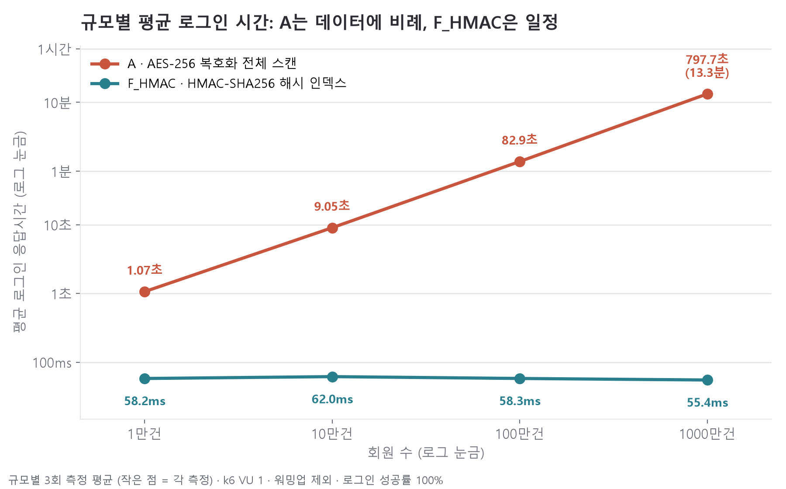
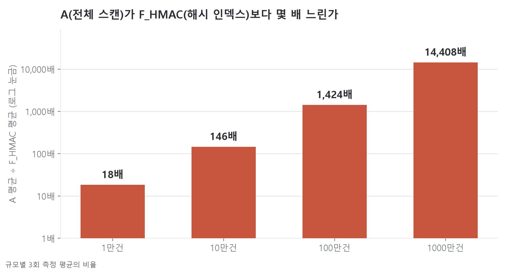

# aes256-hash-benchmark

비결정적 AES256 암호화 컬럼을 SHA-256 / HMAC-SHA256 해시 매핑(blind index)으로 조회하는
구조를, PostgreSQL에서 최대 1000만 건 규모까지 부하 테스트로 검증하는 프로젝트.

**측정 결과: [summary.md](summary.md)** — 1만~1000만 건 규모별 A(AES 전체 스캔) vs F_HMAC(해시 인덱스) 로그인 성능

> 이 저장소는 [`암호화된 회원정보 조회 성능 검증 계획서`](#참고)의 구현체다. 계획서의
> 가설(H1 부터 H6)과 측정 방법은 그대로 따르고, 여기서는 "계획서가 요구하는 시스템을 어떻게
> 만들었는지"와 "어떻게 실행하는지"를 설명한다.

## 측정 결과

시간 복잡도는 예상대로 A(AES 전체 스캔)는 **O(n)**, F_HMAC(해시 인덱스)은 **O(1)**이었다.
1000만 건에서 A는 평균 797.7초(13.3분), F_HMAC은 55.4ms로 약 14,408배 차이가 났다.





자세한 수치는 [summary.md](summary.md) 참고.

## 비교 구성: A vs F_HMAC

| 구성 | 테이블 | 저장하는 값 | 인덱스 | 로그인 시 이메일 찾는 방법 |
|---|---|---|---|---|
| **A** | `users_a` | AES-256 암호문 | 없음 (PK만) | 모든 행을 복호화해 입력 이메일과 비교 (전체 스캔) |
| **F_HMAC** | `users_f_hmac` | AES-256 암호문 + 이메일의 HMAC-SHA256 값 | `email_hash`에 hash 인덱스 | 입력 이메일의 HMAC 값으로 인덱스를 한 번 조회 |

### 왜 A와 F_HMAC인가

- **A는 문제 상황 그 자체(기준선)다.** AES-256 암호화는 비결정적이라 같은 이메일도 매번 다른
  암호문이 된다. 그래서 암호문만 저장하면 DB가 이메일로 행을 찾을 방법이 없고, 모든 행을
  꺼내 복호화하며 비교할 수밖에 없다. 회원 수에 비례해 느려지는 이 비용이 해결하려는 문제다.
- **F_HMAC은 최종 권장 구조다.** 이메일의 해시 값을 같은 테이블에 함께 저장(blind index)하고
  그 열에 인덱스를 건다.
  - **map 테이블 없이 한 테이블(F 계열):** 조회가 조인 없이 한 번에 끝난다.
  - **hash 인덱스:** 로그인은 "이메일이 정확히 같은 행" 찾기(등치 조회)뿐이라 범위 조회용
    B-tree가 필요 없다.
  - **SHA-256 대신 HMAC-SHA256:** 키 없는 SHA-256은 이메일 목록을 해시해 대조하면 원래
    이메일이 드러난다. HMAC은 서버만 아는 비밀 키가 있어야 같은 값을 만들 수 있다(계획서 11장 보안 권고).
- **해결 전(A)과 해결 후(F_HMAC)를 직접 비교**하면 blind index를 도입한 효과가 가장 분명하게
  드러난다. 중간 단계 구성(B~E, SHA-256 변형)은 측정 시간이 한정돼 있어 이번 측정에서 뺐다.

코드와 스키마에는 계획서 4장의 다른 구성(B~E, C/D/E_HMAC)도 남아 있다. 설계 배경은
[`docs/ARCHITECTURE.md`](docs/ARCHITECTURE.md) 참고.

## 요구 사항

- Java 17, Maven
- Docker / Docker Compose (PostgreSQL 16)
- [k6](https://k6.io/) (부하 테스트)
- `curl` (적재/검증 스크립트가 서버 API를 호출)

## 빠른 시작

```bash
# 1) 환경변수 설정
cp .env.example .env
# .env를 열어 DB_PASSWORD, AES_ENCRYPTION_KEY, HMAC_SECRET_KEY를 원하는 값으로 바꾼다.

# 2) PostgreSQL 기동
docker compose up -d
docker compose ps   # healthy 확인

# 3) 서버 빌드 & 실행 (Flyway가 10개 구성의 테이블을 자동 생성)
./mvnw clean package -DskipTests
set -a; source .env; set +a
java -jar target/ahbench.jar \
  --bench.encryption.key="$AES_ENCRYPTION_KEY" \
  --bench.hmac.key="$HMAC_SECRET_KEY"

# 4) (서버가 뜬 상태에서, 새 터미널) 100건으로 생성기/서비스 일치 확인 — 계획서 6장 1단계
./scripts/verify-sample.sh

# 5) 실제 데이터 생성 (예: 10만 건으로 먼저 소요 시간 확인)
./scripts/generate-data.sh 100000 100000 8

# 6) 해당 규모로 적재 + 인덱스 + ANALYZE
./scripts/load-data.sh 100000

# 7) 같은 규모 N을 A와 F_HMAC 테이블에 적재 (staging.members_hmac 에서 seq <= N 만 옮김)
./load.sh a 100000
./load.sh f_hmac 100000

# 8) 로그인 측정: A와 F_HMAC을 같은 샘플로 차례로 측정 (A 50회, F_HMAC 200회)
./k6/run-compare.sh 100000 50 200

# 9) 결과 정리: summary.md, results/summary.csv, 그래프
python3 k6/lib/collect-results.py
python3 k6/lib/plot-results.py   # matplotlib 필요
```

## 디렉터리 구조

```
src/main/java/com/doh/ahbench/
  common/     ConfigId, ConfigShape, ConfigSpec, ConfigRegistry — 10개 구성 정의
  crypto/     AES256(jasypt), SHA-256, HMAC-SHA256
  security/   비밀번호(bcrypt)
  repo/       JdbcTemplate 기반 데이터 접근 (BenchRowRepository)
  bench/      3가지 shape 핸들러 + 레지스트리
  web/        REST 컨트롤러 (k6가 호출하는 API), 관리용 API
  generator/  CSV 데이터 생성기 (generate 프로필)
src/main/resources/db/migration/   Flyway DDL (테이블만; 인덱스는 적재 후 별도)
sql/indexes.sql                    적재 후 실행하는 인덱스 DDL
scripts/                           생성 → 적재 → 인덱스 → 크기측정 → EXPLAIN 파이프라인
k6/                                로그인 측정 (login_compare.js, run-one.sh, run-compare.sh)
docs/ARCHITECTURE.md               설계 결정과 계획서 대응표
```

## 측정 기능: 로그인

계획서 8장의 시나리오(S1~S5) 중 **S1 로그인**만 측정했다. 이메일로 회원을 찾는 비용이
A와 F_HMAC의 차이가 가장 직접 드러나는 지점이기 때문이다.

| 단계 | A | F_HMAC |
|---|---|---|
| 1. 회원 찾기 | 앞에서부터 행을 하나씩 복호화해 입력 이메일과 비교, 일치하면 멈춤 | 입력 이메일의 HMAC 값으로 hash 인덱스 조회 |
| 2. 비밀번호 확인 | bcrypt 검증 | bcrypt 검증 (+ 찾은 행 1개의 이메일 복호화) |

- 모든 요청은 **존재하는 이메일 + 올바른 비밀번호**로 보내는 성공 로그인이다.
- 조회할 회원은 `seq <= N`에서 고정 시드로 무작위로 뽑고, A와 F_HMAC이 같은 회원을 같은 순서로 조회한다.
- k6 VU 1개로 요청을 하나씩 보내고, 워밍업은 별도 k6 실행으로 돌려 통계에서 뺀다.

| 파일 | 역할 |
|---|---|
| `k6/login_compare.js` | 로그인 요청 + 지표 수집 (`login_ms`, `decrypt_ms`, `login_success`) |
| `k6/run-one.sh <a\|f_hmac> <N> [반복]` | 워밍업 → 측정 → 결과 폴더(`results/<시각>_N<N>/`)에 저장 |
| `k6/run-compare.sh <N> [A 반복] [F 반복]` | A와 F_HMAC을 차례로 측정 |

## 측정 보조 스크립트

| 스크립트 | 역할 |
|---|---|
| `scripts/generate-data.sh` | 데이터 생성기 실행 (청크 CSV 생성) |
| `scripts/load-data.sh <SCALE>` | staging COPY → 10개 구성 테이블 적재 → 인덱스 → ANALYZE → 크기 기록 |
| `scripts/verify-sample.sh` | 100건으로 생성기/서버 간 복호화·해시 일치 확인 |
| `scripts/measure-sizes.sh` | `/api/admin/{config}/size` 결과를 CSV로 저장 |
| `scripts/explain-check.sh <config> <email>` | `EXPLAIN (ANALYZE, BUFFERS)` 결과 저장 |
| `k6/run-all.sh <scenario.js> [config...]` | 구성별 × N회 반복 실행 (중앙값 계산은 결과 취합 시) |

## 한계 (계획서 12장)

- 이 저장소는 노트북 1대 기준 상대 비교·경향 측정용이며, 절대 성능 주장을 하지 않는다.
- 구성 A는 큰 규모에서 끝까지 돌리기 어렵다 — 1만/10만까지만 정식 측정하고, 100만 이상은
  타임아웃 지점 확인용으로만 돌린다 (계획서 4장).
- 데이터는 규칙적으로 생성한 이메일이라 실제 분포와 다를 수 있다. 다만 해시 분포는
  입력과 무관하게 균일하므로 인덱스 성능에는 영향이 작다.
- 이 구조는 blind index라는 기존 패턴이며, 새 기법을 제안하는 것이 아니라 계획서가
  세운 가설을 실측으로 검증하는 것이다.

## 참고

- 계획서: 암호화된 회원정보 조회 성능 검증 계획서 (2026. 10. 15.)
- 블로그: 「문제 해결 11 | 해시 값을 PK로 가지는 테이블을 통해」(2025. 1. 22.)
