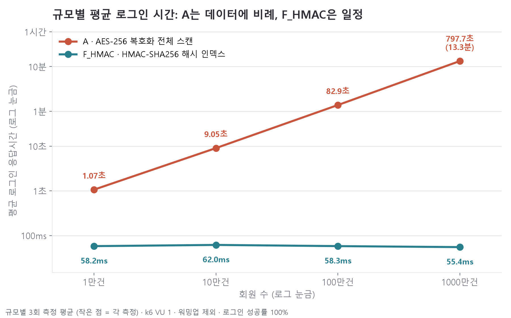
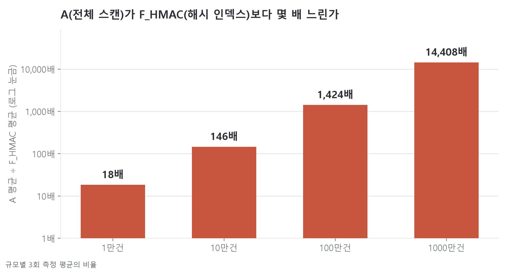

# AES 전체 스캔(A) vs HMAC 해시 인덱스(F_HMAC) 로그인 성능

규모마다 측정 3회의 평균. 원본: 각 결과 폴더의 `k6.log` / `summary.json` / `meta.txt`
(`python3 k6/lib/collect-results.py` 로 다시 만들 수 있음)

## 비교 대상과 측정 기능

| 구성 | 저장하는 값 | 인덱스 | 로그인 시 이메일 찾는 방법 |
|---|---|---|---|
| **A** | AES-256 암호문 | 없음 (PK만) | 모든 행을 복호화해 비교 (전체 스캔) |
| **F_HMAC** | AES-256 암호문 + 이메일의 HMAC-SHA256 값 | `email_hash`에 hash 인덱스 | HMAC 값으로 인덱스를 한 번 조회 |

**왜 A와 F_HMAC인가**

- **A = 해결 전(기준선).** AES-256은 비결정적 암호화라 같은 이메일도 매번 암호문이 다르다.
  암호문만으로는 DB가 이메일로 행을 찾을 수 없어, 모든 행을 복호화하며 비교해야 한다.
- **F_HMAC = 해결 후(최종 권장 구조).** 이메일의 해시 값을 같은 테이블에 저장(blind index)하고
  hash 인덱스를 건다. 로그인은 등치 조회뿐이라 hash 인덱스면 충분하고, map 테이블 조인도 없다.
  해시는 SHA-256 대신 비밀 키가 필요한 HMAC-SHA256을 써서 이메일 목록 대입으로 원래 이메일을
  알아낼 수 없게 했다.
- 두 끝을 직접 비교하면 blind index 도입 효과가 가장 분명하게 드러난다. 중간 단계 구성(B~E)은
  측정 시간이 한정돼 있어 뺐다.

**측정 기능: 로그인만.** 계획서 시나리오(S1~S5) 중 S1 로그인만 측정했다. 이메일로 회원을 찾는
비용이 두 구성의 차이가 가장 직접 드러나는 지점이다. 모든 요청은 존재하는 이메일 + 올바른
비밀번호로 보내는 성공 로그인이고, A와 F_HMAC이 같은 회원을 같은 순서로 조회한다.

## 한눈에 보기

|  규모  | A (AES 전체 스캔) | F_HMAC (해시 인덱스) | A가 느린 배수 |
|:------:|------------------:|---------------------:|--------------:|
|  1만   |            1.07초 |               58.2ms |          18배 |
|  10만  |            9.05초 |               62.0ms |         146배 |
| 100만  |            82.9초 |               58.3ms |       1,424배 |
| 1000만 |  797.7초 (13.3분) |               55.4ms |      14,408배 |

## 상세

|  규모  |           A 평균 |         A 중앙값 |              A p95 |             A 최대 | A 증가 배율 | F 평균 | F 중앙값 |  F p95 | 요청 수 (A / F) |
|:------:|-----------------:|-----------------:|-------------------:|-------------------:|:-----------:|-------:|---------:|-------:|:---------------:|
|  1만   |           1.07초 |           1.04초 |             2.04초 |             2.49초 |      –      | 58.2ms |   58.8ms | 61.5ms |    200 / 200    |
|  10만  |           9.05초 |           7.93초 |            18.41초 |            23.54초 |    ×8.5     | 62.0ms |   61.4ms | 68.2ms |    50 / 200     |
| 100만  |           82.9초 |           66.3초 |            165.6초 |            199.0초 |    ×9.2     | 58.3ms |   57.8ms | 61.1ms |    20 / 200     |
| 1000만 | 797.7초 (13.3분) | 727.6초 (12.1분) | 1,668.1초 (27.8분) | 1,829.7초 (30.5분) |    ×9.6     | 55.4ms |   54.7ms | 58.2ms |    10 / 200     |

- **A 증가 배율**: 바로 아래 규모보다 A 평균이 몇 배 늘었는지. 데이터가 10배 늘 때 A도 거의 10배씩 늘었다.
- **F_HMAC**: 규모와 상관없이 거의 일정하다. 대부분이 bcrypt 비밀번호 검증 시간이다.
- **요청 수**: 측정 1회당 요청 수. 워밍업은 별도 k6 실행으로 돌려 통계에 들어가지 않는다.
- 모든 측정에서 로그인 성공률 100%.

## 시간 복잡도: 예상대로 A는 O(n), F_HMAC은 O(1)

- **A (AES 전체 스캔) = O(n)**: 행을 앞에서부터 하나씩 복호화해 비교하므로 읽는 행 수에 비례한다.
  규모-시간 로그-로그 기울기가 **0.958** (1이면 O(n)) — 데이터가 10배 늘 때 시간도 약 10배 늘었다.
- **F_HMAC (해시 인덱스) = O(1)**: 이메일의 HMAC 값으로 hash 인덱스를 한 번 조회한다.
  로그-로그 기울기가 **-0.009** (0이면 O(1)) — 1만 건부터 1000만 건까지 응답시간이 거의 같았다.

A는 일치하는 행(seq번째)을 찾으면 멈추므로, 요청별 응답시간을 `고정 시간 + 행당 비용 × seq` 로 맞춰 보면
규모와 상관없이 행당 비용이 같고 거의 완전한 직선이다(R²가 1에 가까울수록 직선).

|  규모  | A 요청 수 | 행 1천 개당 시간 |    R² |
|:------:|----------:|-----------------:|------:|
|  1만   |       600 |          208.1ms | 0.978 |
|  10만  |       150 |          208.1ms | 0.995 |
| 100만  |        60 |          208.2ms | 0.999 |
| 1000만 |        30 |          207.6ms | 0.999 |

평균 증가 배율이 정확히 10배가 아니라 조금 작은 이유는 (1) 행 수와 무관한 고정 비용(bcrypt 검증·HTTP, 약 60ms)이
작은 규모에서 비중이 크고, (2) 무작위로 뽑은 seq의 평균 위치가 규모마다 조금 달랐기 때문이다.

## 측정 조건

| 항목 | 값 |
|------|----|
| 부하 | k6, VU 1, 고정 반복 횟수 |
| 워밍업 | A: 1만 5회 · 10만 3회 · 100만 2회 · 1000만 1회 / F_HMAC: 5회 |
| PostgreSQL | 16, 메모리 5GB, CPU 3, shared_buffers 2GB |
| 앱 서버 | Spring Boot, 메모리 2GB, CPU 3, 힙 1GB |
| 로그인 | 존재하는 이메일 + 올바른 비밀번호, A·F_HMAC이 같은 seq를 같은 순서로 조회 |

## 전체 측정 기록

| 실행                      |  구성  |  규모  | 워밍업 | 요청 수 |             평균 |           중앙값 |                p95 |               최대 | 성공률 |
|---------------------------|:------:|:------:|:------:|--------:|-----------------:|-----------------:|-------------------:|-------------------:|-------:|
| 20261115-154914_N10000    |   a    |  1만   |  5회   |     200 |           1.12초 |           1.10초 |             2.18초 |             2.49초 |   100% |
| 20261115-154914_N10000    | f_hmac |  1만   |  5회   |     200 |           59.8ms |           60.8ms |             65.4ms |             71.7ms |   100% |
| 20261115-155635_N10000    |   a    |  1만   |  5회   |     200 |           1.03초 |           1.04초 |             1.98초 |             2.11초 |   100% |
| 20261115-155635_N10000    | f_hmac |  1만   |  5회   |     200 |           57.4ms |           57.7ms |             59.6ms |             62.5ms |   100% |
| 20261115-160310_N10000    |   a    |  1만   |  5회   |     200 |           1.04초 |           1.00초 |             1.95초 |             2.12초 |   100% |
| 20261115-160310_N10000    | f_hmac |  1만   |  5회   |     200 |           57.4ms |           57.8ms |             59.5ms |             64.4ms |   100% |
| 20261115-162356_N100000   |   a    |  10만  |  3회   |      50 |           8.88초 |           7.77초 |            18.36초 |            20.37초 |   100% |
| 20261115-162356_N100000   | f_hmac |  10만  |  5회   |     200 |           60.3ms |           58.9ms |             64.5ms |             88.8ms |   100% |
| 20261115-163250_N100000   |   a    |  10만  |  3회   |      50 |           8.88초 |           7.60초 |            18.36초 |            20.37초 |   100% |
| 20261115-163250_N100000   | f_hmac |  10만  |  5회   |     200 |           59.8ms |           58.6ms |             67.6ms |             83.9ms |   100% |
| 20261115-164536_N100000   |   a    |  10만  |  3회   |      50 |           9.38초 |           8.42초 |            18.52초 |            23.54초 |   100% |
| 20261115-164536_N100000   | f_hmac |  10만  |  5회   |     200 |           65.7ms |           66.8ms |             72.5ms |             94.0ms |   100% |
| 20261115-170032_N1000000  |   a    | 100만  |  2회   |      20 |           83.0초 |           66.1초 |            165.2초 |            197.7초 |   100% |
| 20261115-170032_N1000000  | f_hmac | 100만  |  5회   |     200 |           55.4ms |           55.2ms |             56.9ms |             57.9ms |   100% |
| 20261115-173557_N1000000  |   a    | 100만  |  2회   |      20 |           82.6초 |           66.0초 |            164.6초 |            197.1초 |   100% |
| 20261115-173557_N1000000  | f_hmac | 100만  |  5회   |     200 |           59.8ms |           59.0ms |             63.7ms |            104.5ms |   100% |
| 20261115-181542_N1000000  |   a    | 100만  |  2회   |      20 |           83.3초 |           66.7초 |            166.8초 |            199.0초 |   100% |
| 20261115-181542_N1000000  | f_hmac | 100만  |  5회   |     200 |           59.6ms |           59.1ms |             62.9ms |             88.1ms |   100% |
| 20261115-190347_N10000000 |   a    | 1000만 |  1회   |      10 | 811.0초 (13.5분) | 738.5초 (12.3분) | 1,692.7초 (28.2분) | 1,829.7초 (30.5분) |   100% |
| 20261115-190347_N10000000 | f_hmac | 1000만 |  5회   |     200 |           55.8ms |           54.8ms |             60.5ms |             73.6ms |   100% |
| 20261115-215401_N10000000 |   a    | 1000만 |  1회   |      10 | 801.5초 (13.4분) | 731.0초 (12.2분) | 1,681.1초 (28.0분) | 1,793.8초 (29.9분) |   100% |
| 20261115-215401_N10000000 | f_hmac | 1000만 |  5회   |     200 |           55.3ms |           54.7ms |             57.9ms |             80.3ms |   100% |
| 20261116-004244_N10000000 |   a    | 1000만 |  1회   |      10 | 780.6초 (13.0분) | 713.3초 (11.9분) | 1,630.4초 (27.2분) | 1,749.6초 (29.2분) |   100% |
| 20261116-004244_N10000000 | f_hmac | 1000만 |  5회   |     200 |           54.9ms |           54.5ms |             56.1ms |            110.7ms |   100% |
